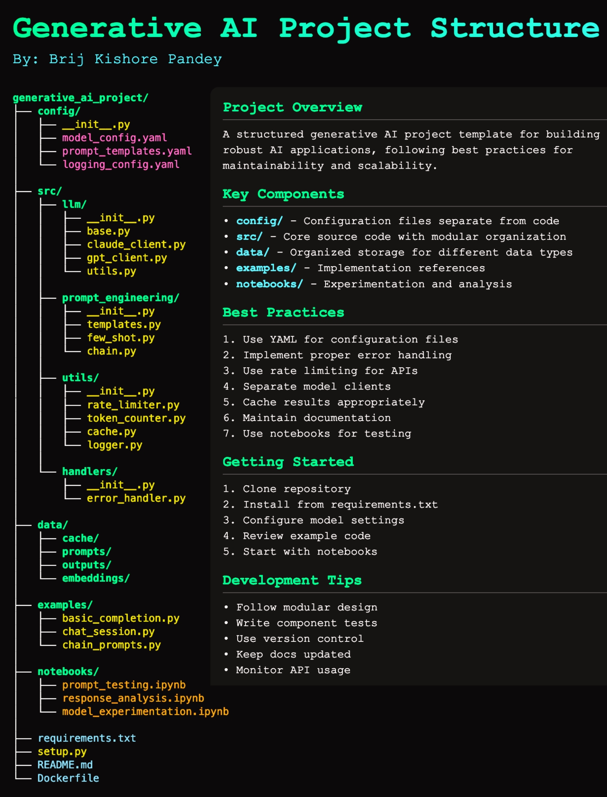

# Generative AI Application Framework

### A Modular Framework for Building LLM-Powered Applications



## Overview

The **Generative AI Application Framework** is a Python-based project designed to provide a modular and reusable foundation for developing applications powered by Large Language Models (LLMs).

The project aims to simplify the development of Generative AI applications by organizing essential components such as LLM provider integration, prompt engineering, API management, token counting, response caching, and error handling into separate modules.

The framework is designed with extensibility in mind, allowing developers to integrate different AI model providers and build customized AI-powered applications.

## Project Objectives

- Develop a modular architecture for Generative AI applications.
- Integrate multiple Large Language Model providers.
- Support OpenAI GPT and Anthropic Claude integrations.
- Organize reusable prompt engineering techniques.
- Manage API requests and token consumption.
- Introduce response caching to reduce repeated API calls.
- Improve reliability through logging and error handling.
- Provide a foundation for future AI-powered applications.

## Key Features

| Feature | Description |
|---|---|
| Modular Architecture | Organized components for maintainability and extensibility |
| LLM Integration | Planned support for OpenAI GPT and Anthropic Claude |
| Prompt Engineering | Reusable templates and few-shot prompting |
| Prompt Chaining | Structure multi-step AI workflows |
| Token Management | Utilities for monitoring token consumption |
| Rate Limiting | Manage API request frequency |
| Response Caching | Store and reuse suitable previous responses |
| Error Handling | Centralized application error management |
| Experimentation | Notebooks for prompt and model experimentation |

## System Architecture

The framework is organized into five major layers:

1. **Configuration Layer** – Manages model settings, prompt templates, and logging configuration.
2. **LLM Integration Layer** – Provides a common structure for connecting different language model providers.
3. **Prompt Engineering Layer** – Organizes prompt templates, few-shot examples, and prompt chaining.
4. **Utility Layer** – Supports token counting, rate limiting, caching, and logging.
5. **Experimentation Layer** – Provides example workflows and notebooks for testing and analysis.

## Project Structure

```text
generative-ai-application-framework/
│
├── config/
│   ├── __init__.py
│   ├── model_config.yaml
│   ├── prompt_templates.yaml
│   └── logging_config.yaml
│
├── data/
│   ├── cache/
│   │   └── sample.json
│   ├── prompts/
│   │   └── sample.json
│   ├── outputs/
│   │   ├── sample.json
│   │   └── embeddings/
│   │       └── sample.json
│   ├── sample.json
│   ├── Generative_AI_Mastery_Checklist_Comprehensive.pdf
│   └── Generative_AI_Mastery_Checklist_Comprehensive.docx
│
├── examples/
│   ├── basic_completion.py
│   ├── chat_session.py
│   ├── chain_prompts.py
│   └── genai_project.jpg
│
├── notebooks/
│   ├── prompt_testing.ipynb
│   ├── response_analysis.ipynb
│   └── model_experimentation.ipynb
│
└── src/
    ├── handlers/
    │   └── error_handler.py
    │
    ├── llm/
    │   ├── base.py
    │   ├── openai_client.py
    │   ├── claude_client.py
    │   └── utils.py
    │
    ├── prompt_engineering/
    │   ├── templates.py
    │   ├── few_shot.py
    │   └── chain.py
    │
    └── utils/
        ├── cache.py
        ├── logger.py
        ├── rate_limiter.py
        └── token_counter.py
```

## Technologies

| Technology | Purpose |
|---|---|
| Python | Core development language |
| OpenAI API | GPT model integration |
| Anthropic API | Claude model integration |
| YAML | Configuration management |
| JSON | Structured data storage |
| Jupyter Notebook | Experimentation and analysis |
| Git & GitHub | Version control and collaboration |

## Getting Started

### Prerequisites

- Python 3.10 or later
- pip
- Git
- API credentials for the model provider you intend to use

### 1. Clone the Repository

```bash
git clone https://github.com/lokeshsolomon/generative-ai-application-framework.git
```

### 2. Navigate to the Project

```bash
cd generative-ai-application-framework
```

### 3. Create a Virtual Environment

```bash
python -m venv venv
```

Activate it on Windows:

```powershell
venv\Scripts\activate
```

Activate it on macOS or Linux:

```bash
source venv/bin/activate
```

### 4. Install Dependencies

The project dependency list is currently being prepared. Install the packages required by the modules as they are implemented.

### 5. Configure API Credentials

Use environment variables to store provider API credentials.

Example for Windows PowerShell:

```powershell
$env:OPENAI_API_KEY="your-openai-api-key"
$env:ANTHROPIC_API_KEY="your-anthropic-api-key"
```

Never commit API keys or other sensitive credentials to GitHub.

## Core Modules

### LLM Integration

The `src/llm/` module is designed to provide a common interface for interacting with different LLM providers.

- `base.py` – Common LLM interface.
- `openai_client.py` – OpenAI integration.
- `claude_client.py` – Anthropic Claude integration.
- `utils.py` – Shared LLM utilities.

### Prompt Engineering

The `src/prompt_engineering/` module is designed to provide reusable prompt-building functionality.

- `templates.py` – Prompt template management.
- `few_shot.py` – Few-shot prompting.
- `chain.py` – Multi-step prompt workflows.

### Utility Components

The `src/utils/` module is intended to manage:

- API rate limiting.
- Token counting.
- Response caching.
- Application logging.

### Error Handling

The `src/handlers/` module is intended to centralize application and API error handling.

## Experimentation

The `notebooks/` directory is organized for future experimentation:

- `prompt_testing.ipynb` – Prompt experimentation.
- `response_analysis.ipynb` – Generated response analysis.
- `model_experimentation.ipynb` – Model experimentation.

The `examples/` directory provides planned reference workflows for basic completion, chat sessions, and prompt chaining.

## Development Roadmap

- [ ] Implement the base LLM interface.
- [ ] Develop OpenAI API integration.
- [ ] Develop Anthropic Claude integration.
- [ ] Implement reusable prompt templates.
- [ ] Add few-shot prompting.
- [ ] Develop prompt chaining.
- [ ] Implement token counting.
- [ ] Add API rate limiting.
- [ ] Implement response caching.
- [ ] Add centralized logging and error handling.
- [ ] Develop and test example applications.
- [ ] Complete experimentation notebooks.
- [ ] Add automated testing.
- [ ] Develop a user interface.
- [ ] Explore Retrieval-Augmented Generation (RAG).
- [ ] Explore AI agent workflows.

## Future Enhancements

Potential future improvements include:

- Retrieval-Augmented Generation (RAG).
- Vector database integration.
- Embedding-based semantic search.
- Multi-modal AI capabilities.
- AI agent workflows and tool calling.
- Advanced model evaluation.
- Scalable application deployment.
- Interactive web-based interface.

## Project Status

**Status: Under Development**

This repository currently provides the initial project structure and architectural foundation. Individual modules, API integrations, examples, and experimentation workflows are planned for progressive implementation.

## Contributing

Contributions, suggestions, and improvements are welcome.

1. Fork the repository.
2. Create a new feature branch.
3. Make your changes.
4. Submit a pull request.

## Author

**Lokesh B**

GitHub: [@lokeshsolomon](https://github.com/lokeshsolomon)

## License

A license has not yet been added to this repository. Licensing information will be provided in a future update.

---

⭐ If you find this project interesting, consider starring the repository!

**Building modular and reusable Generative AI applications.**
